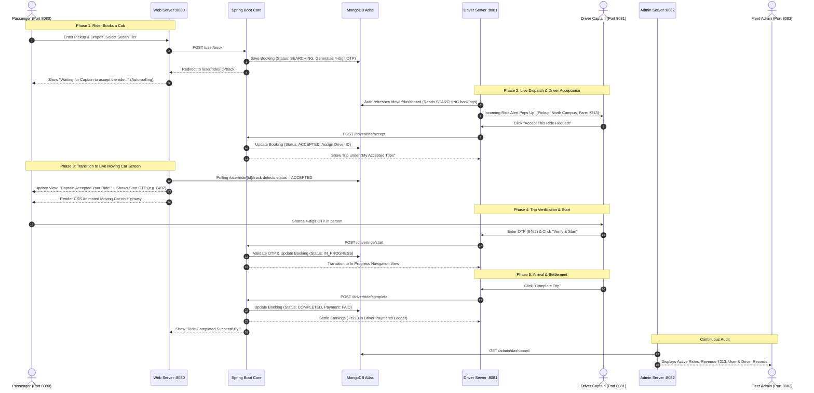
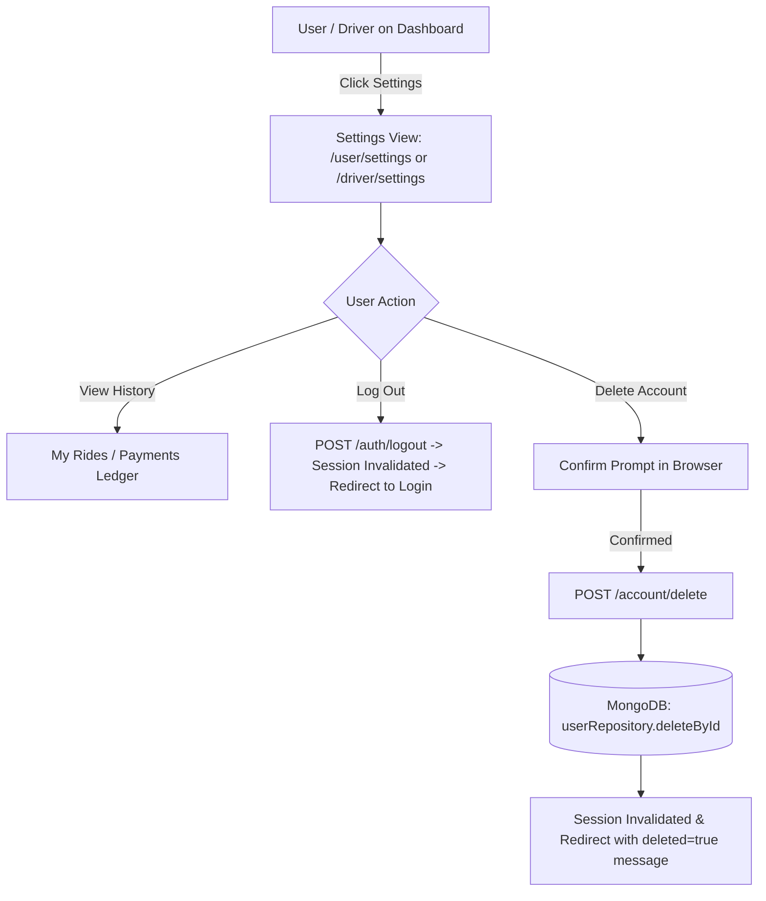

# RideEase — Application Flow & User Journeys

This document details the multi-port application flows and lifecycle transitions across all platform actors.

---

## 1. End-to-End Ride Booking, Acceptance & Trip Completion Flow

---

## 2. User & Driver Account Management & Deletion Flow

---

## 3. Trip State Machine Transition Rules

| Initial State | Trigger Event | Target State | Authorized Actor | Real-Time UI Reflection |
|---|---|---|---|---|
| *(New)* | User submits booking form | `SEARCHING` | Passenger (Port 8080) | User views spinner: *"Waiting for Captain to accept..."* |
| `SEARCHING` | Driver clicks "Accept Ride" | `ACCEPTED` | Driver (Port 8081) | User views Captain details, OTP code & animated car |
| `SEARCHING` | Rider cancels request | `CANCELLED` | Passenger (Port 8080) | Removed from Driver's incoming radar |
| `ACCEPTED` | Driver enters matching 4-digit OTP | `IN_PROGRESS` | Driver (Port 8081) | Animated highway car shows *"Trip in Progress"* |
| `IN_PROGRESS`| Driver reaches destination & completes | `COMPLETED` | Driver (Port 8081) | Fare recorded as `PAID`, added to Driver earnings |
| `SEARCHING` / `ACCEPTED` | Admin cancels | `CANCELLED` | Admin (Port 8082) | Status marked cancelled across both portals |
