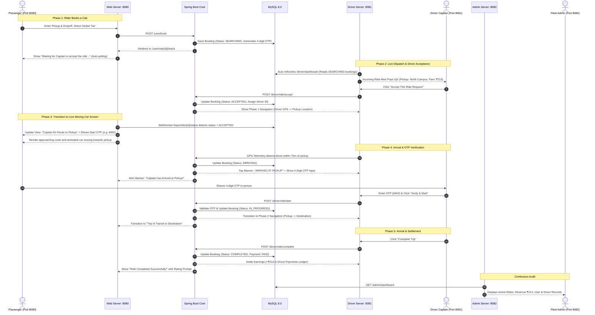
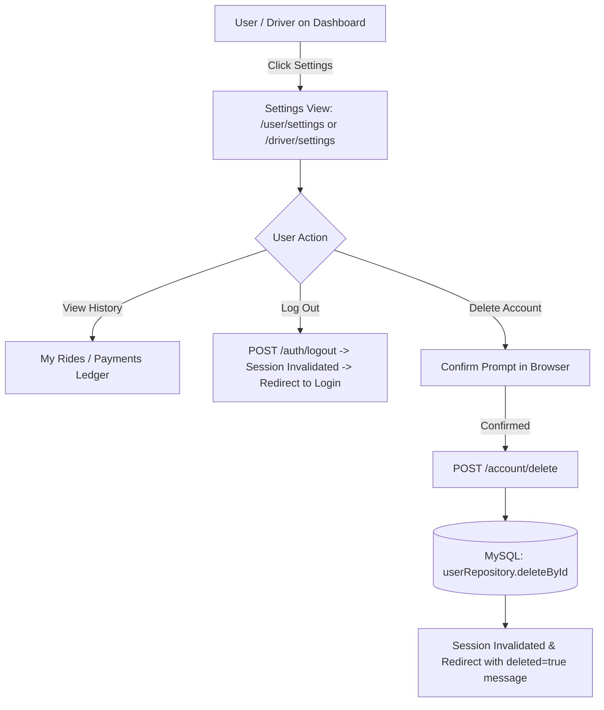

# RideEase — Application Flow & User Journeys

This document details the multi-port application flows and lifecycle transitions across all platform actors.

---

## 1. End-to-End Ride Booking, Acceptance & Trip Completion Flow

---

## 2. User & Driver Account Management & Deletion Flow

---

## 3. Trip State Machine Transition Rules

| Initial State | Trigger Event | Target State | Authorized Actor | Real-Time UI Reflection |
|---|---|---|---|---|
| *(New)* | User submits booking form | `SEARCHING` | Passenger (Port 8080) | Radar search wave: *"Searching for nearby captains"* |
| `SEARCHING` | Driver clicks "Accept Ride" | `ACCEPTED` | Driver (Port 8081) | Driver navigates to pickup; Rider tracks captain approaching with OTP badge |
| `SEARCHING` | Rider cancels request | `CANCELLED` | Passenger (Port 8080) | Removed from Driver's incoming radar instantly |
| `ACCEPTED` | Driver approaches pickup (<75m) | `ARRIVING` | System / GPS Telemetry | Driver terminal prompts for OTP; Rider receives "Captain has arrived" banner |
| `ACCEPTED` / `ARRIVING` | Driver enters matching 4-digit OTP | `IN_PROGRESS` | Driver (Port 8081) | Pickup route clears, map navigates to destination, rider tracking reflects trip in transit |
| `ACCEPTED` / `ARRIVING` / `IN_PROGRESS` | Driver drops ride (emergency) | `CANCELLED` | Driver (Port 8081) | Driver marked available, rider tracking notifies cancellation and redirects |
| `IN_PROGRESS`| Driver reaches destination & completes | `COMPLETED` | Driver (Port 8081) | Fare recorded as `PAID`, added to Driver earnings, rider submits rating |
| Any Active State | Admin cancels ride from ledger | `CANCELLED` | Admin (Port 8082) | Status marked cancelled instantly across driver and rider screens |
