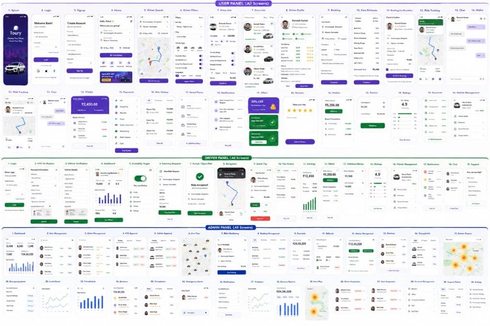

# RideEase — UI/UX Design System & Screen Blueprint (Toury / RideEase)

> Based on the Master Multi-Panel Design Specification (User Panel, Driver Panel, and Admin Panel).

---

## 1. Visual Theme & Styling Tokens

- **Brand Aesthetic:** Modern Purple & Indigo Neo-Mobility theme with emerald accents.
- **Color Hierarchy:**
  - `Primary / Accent`: `#6366F1` (Indigo 500) & `#7C3AED` (Purple 600)
  - `User Panel Primary`: Purple Gradient (`#4F46E5` -> `#7C3AED`)
  - `Driver Panel Primary`: Emerald Forest (`#059669` -> `#10B981`)
  - `Admin Panel Primary`: Royal Navy (`#1E293B` -> `#0F172A` with `#2563EB` badges)
  - `Surface / Background`: `#F8FAFC` (Slate 50) and Crisp White `#FFFFFF`
  - `Cards & Borders`: Border `#E2E8F0` with subtle elevation shadows (`0 4px 14px rgba(0,0,0,0.06)`)
  - `Status Colors`:
    - Success / Active: `#10B981` (Green)
    - Pending / Searching: `#F59E0B` (Amber)
    - Danger / Emergency SOS: `#EF4444` (Crimson Red)

---

## 2. Panel Breakdown & Detailed Screen Flow

### Section A: USER PANEL (Screens 1 to 20)

| Screen # | Screen Name | Key UI Elements & Interactive Components |
|---|---|---|
| **1** | **Splash Screen** | "Toury / RideEase" branding, gradient purple backdrop, hero cab graphic, taglines |
| **2** | **Login** | Mobile/Email input, password toggle, Social logins (Google, Apple), "Sign In" button |
| **3** | **Signup / Register** | Full Name, Email, Phone number, Password, Role selector, Terms checkbox |
| **4** | **Home Dashboard** | User greeting ("Hello, Rahul"), "Where are you going?" search bar, Recent & Saved locations, promo banner |
| **5** | **Driver Search** | Interactive map with route polyline, pickup & drop pin markers, "Searching for Drivers..." |
| **6** | **Driver Filters** | Sort by: Rating, Fare (Low to High), Vehicle Type (Mini, Sedan, SUV, EV), AC/Non-AC, Languages |
| **7** | **Driver List** | Live candidate cards showing driver photo, name, rating badge (e.g. 4.88 ★), vehicle model, ETA, Fare |
| **8** | **Driver Profile** | Detailed driver bio, badges (Top Rated, Long Trip, Sanitized), vehicle registration, verified license |
| **9** | **Booking Setup** | Pickup & drop-off time picker, luggage count, passenger count, one-way or round-trip |
| **10** | **Fare Estimate** | Itemized breakdown: Base fare, distance charge, platform fee, estimated toll, GST (18%), total |
| **11** | **Booking Confirmation** | Review trip summary, driver assignment card, payment method selector, "Confirm Booking" button |
| **12** | **Ride Tracking** | Live map route, driver moving marker, ETA countdown, "Driver Arriving in 3 mins" |
| **13** | **Chat / Call** | In-app messaging with driver ("I am on the way", "OK, see you soon") & direct call trigger |
| **14** | **Wallet** | Available balance card (e.g. ₹2,450.00), "Add Money", "Transactions", quick deposit chips |
| **15** | **Payments** | Payment gateway choices: UPI (GPay, PhonePe, Paytm), Cards, Net Banking, Cash on Trip |
| **16** | **Ride History** | Past trips list (Mysore Trip, Coorg Trip, Airport Trip), date, fare, status tag (Completed/Cancelled) |
| **17** | **Saved Places** | Home, Work, Favorite Airport/Station tags with 1-click booking shortcuts |
| **18** | **Notifications** | Alerts: "Driver Assigned", "Ride Completed", "20% Promo Unlocked" |
| **19** | **Offers & Discounts** | Coupons list: `TOUR20` (20% OFF), `RIDE100` (Flat ₹100 OFF), "Apply Promo" |
| **20** | **Reviews & Ratings** | Post-trip 5-star rating selector, compliments badges (Clean Cab, Polite Driver), written feedback |

---

### Section B: DRIVER PANEL (Screens 1 to 19)

| Screen # | Screen Name | Key UI Elements & Interactive Components |
|---|---|---|
| **1** | **Driver Login** | Phone/Email, password, driver ID lookup |
| **2** | **KYC Verification** | Aadhaar/Passport, Driving License number and Cloudinary photo document upload preview |
| **3** | **Vehicle Verification** | Vehicle category (Mini, Sedan, SUV), RC book photo, Plate number, model year |
| **4** | **Driver Dashboard** | Today's Earnings (e.g. ₹3,450), Completed Trips count, Online hours, Weekly earnings bar chart |
| **5** | **Availability Toggle** | Large iOS-style switch: "You are Online" (Green) / "Offline" |
| **6** | **Incoming Request** | 15-second countdown timer, Fare (₹210), Pickup distance (1.2 km), Accept / Reject buttons |
| **7** | **Accept Confirmation** | Success badge: "Ride Accepted!", Passenger details, "Start Navigation" button |
| **8** | **Navigation & Route** | Full-screen turn-by-turn map guidance to passenger pickup location |
| **9** | **Active Trip Screen** | Passenger card, OTP input box (`_ _ _ _`), "Start Trip" and "Complete Trip" buttons |
| **10** | **Trip History** | Driver ride logs, gross earned per trip, platform commission deduction, tips |
| **11** | **Earnings Analytics** | Daily, Weekly, and Monthly income charts, incentive bonuses |
| **12** | **Driver Wallet** | Balance card (₹5,250.00), "Withdraw to Bank Account" button, recent settlements |
| **13** | **Withdraw Money** | Bank IFSC, Account Number, Amount entry, instant payout trigger |
| **14** | **Ratings & Feedback** | Driver average score (e.g. 4.9 ★), breakdown of 5-star to 1-star reviews, passenger comments |
| **15** | **Vehicle Management** | Registered car photo, fitness certificate status, switch vehicle option |
| **16** | **Driver Notifications** | System alerts: Document expiry warnings, peak hour surge notifications |
| **17** | **Driver Chat** | Live chat with passenger during pickup |
| **18** | **Support & SOS** | 24/7 driver emergency helpline, issue ticketing (fare dispute, passenger misconduct) |

---

### Section C: ADMIN PANEL (Screens 1 to 24)

| Screen # | Screen Name | Key UI Elements & Interactive Components |
|---|---|---|
| **1** | **Admin Dashboard** | Fleet KPI counters (Active Rides, Total Drivers, Gross Revenue ₹24.58L), Live trends graph |
| **2** | **User Management** | Searchable table of registered riders, verification status, ride count, ban/unban actions |
| **3** | **Driver Management** | Full driver directory, vehicle tie-up, online status indicator, overall ratings |
| **4** | **KYC Approvals** | Pending driver documents queue, 1-click modal preview from Cloudinary, Approve / Reject |
| **5** | **Vehicle Approvals** | Vehicle inspection queue (RC & car photos), Category assignment (Mini, Sedan, SUV) |
| **6** | **Live Trips Map** | Real-time map displaying all current in-progress rides across the city with live markers |
| **7** | **Ride Monitoring** | Individual ride telemetry, current speed, route deviation detection, driver/rider cards |
| **8** | **Booking Management** | Comprehensive filterable ledger of all bookings (Requested, Completed, Cancelled) |
| **9** | **Payments Ledger** | Transaction IDs, payment gateways, platform commission vs driver payouts |
| **10** | **Refunds Management** | Passenger refund requests, dispute amount, approve/reject refund triggers |
| **11** | **Wallet Management** | Platform floating balance, driver wallet balances, pending withdrawal transfers |
| **12** | **Reviews & Moderation** | Public review feed, flag inappropriate reviews, driver performance warnings |
| **13** | **Complaints & Tickets** | Helpdesk ticketing system (Lost items, overcharging, safety disputes) |
| **14** | **Revenue Reports** | Monthly financial charts, platform net margin, tax compliance exports (CSV/PDF) |
| **15** | **Heat Map** | High-demand vs low-cab density geographic heat map for surge pricing control |
| **16** | **Emergency Alerts / SOS** | High-priority emergency console receiving passenger/driver distress pings with exact GPS |
| **17** | **Fare Settings** | Dynamic base fare, per-km rate, per-minute rate, and surge multiplier controls |
| **18** | **Promotions & Coupons** | Create discount codes, percentage or flat discount, expiry dates, usage limits |
| **19** | **Driver Suspension** | Blacklist management, temporary suspension with reason logging |
| **20** | **User Suspension** | Rider abuse controls, fraud flags |
| **21** | **Content Management** | Terms of service, privacy policy, FAQ management |
| **22** | **System Settings** | API keys (Cloudinary, Google Maps), notification providers, database health |

---

## 3. Pure Java Full-Stack Implementation Architecture

To build the frontend **using only Java**, we utilize **Java Swing / JavaFX modern desktop client + Java Spring Boot with Thymeleaf & Bootstrap UI**:

1. **Java Spring Boot + Thymeleaf Engine (Web Frontend):**
   - 100% Java-rendered frontend using Spring Boot Controllers returning Thymeleaf HTML5 templates styled with the exact purple/emerald design system tokens.
   - Clean, lightweight, responsive browser-accessible UI without needing Node.js or npm.
   - Direct integration with Spring Security, WebSocket STOMP, MongoDB, and Cloudinary.

2. **Java Android Client:**
   - 100% Java Android App using native Java Views, Activities, and Fragments mirroring the User & Driver screens.
